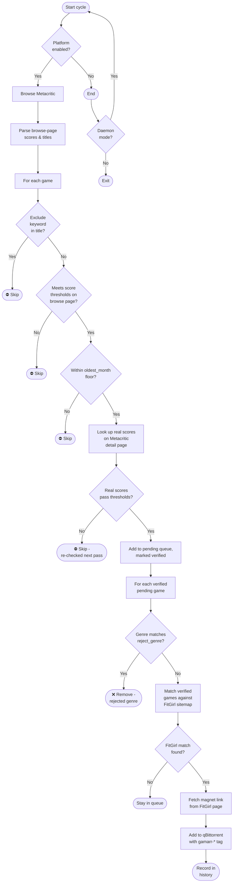

# gamarr

**gamarr** finds great games and puts them in your library — no browsing,
no manual searches, no cleanup. A configurable pipeline scrapes Metacritic
for critically-acclaimed releases, filters out unwanted genres and keywords,
matches titles against FitGirl repacks and FreeGOG, and delivers
torrents to qBittorrent. Once downloads complete, a post-processing thread
SHA-256-verifies and copies each game to your library with customizable path
templates, then cleans up source torrents. Runs as a daemon so your library
stays fresh without lifting a finger.

## Features

- **Two-phase score verification** — browse pages use internal Metacritic
  metrics (not real 0–100 scores) to build a candidate pool quickly.
  Browse scores are on a completely different scale (e.g. 1478, 1931) and
  **always pass** the configured thresholds — the real 0–100 score
  filtering only happens during the detail-page verification step.
  This avoids hundreds of slow HTTP requests while keeping score accuracy.
- **Genre-based rejection** — exclude games by genre using case-insensitive
  substring matching (e.g. `["RPG"]` rejects "Action RPG", "JRPG", etc.).
- **Keyword-based filtering** — reject games whose titles or FitGirl page
  description contain specific keywords.
- **Month-window or backlog sweep** — `discovery.latest` re-reads a month
  window every cycle: `discovery.latest.months_per_cycle` (default 1) months
  back from the newest release, optionally floored at
  `discovery.latest.oldest_month`. `discovery.backlog` sweeps instead: `new`
  runs down to `discovery.backlog.new.oldest_month` with per-year cursors, and
  a score sort runs down to `discovery.backlog.score.oldest_month` at year
  grain. A browse page is about a day of PC releases; the measured rate is
  33 pages per month.
- **Verify before queueing** — a game's real Metacritic detail-page scores are
  checked *before* it enters the pending queue, so the queue only ever holds
  games that already pass the thresholds. Games that fail, or whose scores are
  not published yet, are not queued: they are re-checked when a browse pass next
  reaches their pages (every cycle inside the `latest` window, when the
  sweep wraps in `backlog` mode) instead of occupying the queue for days.
- **Source-matching expiry** — a queued (already verified) game waits
  `source_matching_days` for a matching repack (default 60, or `0` for
  indefinite). The window is resolved once per cycle: an enabled FitGirl
  entry's `source_matching_days`, otherwise the first enabled source's value,
  otherwise the top-level default. Every game is queued already verified, so it
  takes that window at insert, and later re-checks do not push the window
  forward, so a verified game with no match still leaves the queue when the
  window lapses.
- **Multiple download sources** — supports FreeGOGPCGames (A-Z list-based)
  and FitGirl repacks (sitemap-based). Sources are configured as an ordered
  list — position determines priority, and the first source with a match
  delivers the torrent.
- **Source priority** — if a game is available on multiple sources, the
  highest-priority source in the config list is used. Games that don't match
  any source remain in the pending queue.
- **Database deduplication** — every processed game is recorded in SQLite;
  previously processed titles are never re-processed.
- **Configurable cache TTLs** — Metacritic scores and browse pages are cached
  with independent TTLs to reduce HTTP requests.
- **Notifications** — sends alerts via any
  [apprise](https://github.com/caronc/apprise)-compatible service (ntfy,
  Discord, Telegram, email, and more).
- **Schedule mode** — runs as a scheduled background process with separate
  intervals for acquisition and post-processing, or in foreground mode for
  single-pass execution.
- **Automatic config migration** — upgrades the YAML config schema
  automatically on startup when new fields are added.
- **One-time queue cleanup** — on first start after upgrading, pending games that never passed
  detail verification are deleted. They are re-discovered when a browse pass next reaches their
  pages (every cycle inside the `latest` window, when the sweep wraps in `backlog` mode).
  Verified games awaiting a source match are kept.
- **Post-processing** — a background thread polls qBittorrent for completed
  downloads, copies them to a configurable library path with SHA-256
  verification, and cleans up source torrents after seeding goals are met.
  Torrents whose metadata has not been fetched yet (a paused magnet holds no
  files) are not complete: they are skipped quietly and reported once per cycle
  in the summary line (`N downloading, M awaiting metadata`), never as a copy
  failure.

## Prerequisites

- [Python 3.12+](https://www.python.org/downloads/)
- [Astral uv](https://github.com/astral-sh/uv#installation)
- [qBittorrent](https://www.qbittorrent.org/) with WebUI enabled

## Quick start

### Installation

```bash
git clone https://github.com/binhex/gamarr
cd gamarr
uv venv --quiet
uv sync
```

### Usage

```bash
# Validate configuration
gamarr --test

# Run a single acquisition cycle
gamarr
```

## CLI Options

| Option | Description |
| ------ | ----------- |
| `--config-path <dir>` | Directory containing `gamarr.yml` (default: `configs`) |
| `--log-level <level>` | Override console log level (DEBUG, INFO, SUCCESS, WARNING, ERROR) |
| `--log-path <dir>` | Override the log file directory from config (logs are written to `<dir>/gamarr.log`). |
| `--db-path <dir>` | Override the database directory from config |
| `--pid-path <dir>` | Override the PID file directory from config |
| `--library-path <paths>` | Override library paths (pipe-separated: `--library-path /a\|/b`) |
| `--qbt-host <host>` | Override qBittorrent host from config |
| `--qbt-port <port>` | Override qBittorrent WebUI port from config |
| `--qbt-username <user>` | Override qBittorrent username from config |
| `--qbt-password <pass>` | Override qBittorrent password from config |
| `--clear-cache <sources>` | Clear cached data. Comma-separated: `freegog`, `fitgirl`, `metacritic`, or `all` |
| `--test` | Validate configuration and exit |
| `--version` | Show version and exit |
| `--help` | Show help message and exit |

## Configuration

All behaviour is controlled by a YAML file inside the config directory
(`configs/gamarr.yml` by default). A default config is created automatically
on first run, including the `discovery` block for every platform, so the keys
are there to edit (an existing file gains them on its next load). The file is
divided into the sections below.

### Top-level settings

| Key | Description | Default |
| --- | ----------- | ------- |
| `source_matching_days` | How long a queued game waits for a matching repack before it leaves the queue. A download source may override it under the same name. `0` = never expires. | `60` |

### `general`

| Key | Description | Default |
| --- | ----------- | ------- |
| `config_version` | Schema version — managed automatically; do not edit. | *(current)* |
| `daemon_mode` | `foreground` or `background`. Scheduling is controlled by `schedule.enabled`. This field is deprecated. | `foreground` |
| `log_level_console` | Console logging level. | `INFO` |
| `log_level_file` | File logging level. | `INFO` |
| `log_path` | Directory for log files (`gamarr.log` is created inside). | `logs` |
| `db_path` | Directory for the SQLite history database (`gamarr.db` is created inside). | `db` |
| `pid_path` | Directory for the PID file (`gamarr.pid` is created inside). | `pids` |
| `library_path_list` | Override library paths from CLI (`--library-path`). Mapped to `library.paths` at runtime. | `[]` |

### `schedule`

| Key | Description | Default |
| --- | ----------- | ------- |
| `enabled` | Enable or disable scheduled background mode. | `false` |
| `schedule_time_mins` | Interval in minutes between scheduled cycles. | `60` |
| `run_on_start` | Run immediately on start, before the first interval. | `true` |
| `acquisition_timeout_mins` | Hard watchdog budget (minutes) for one acquisition cycle. A cycle that exceeds this is aborted so the next scheduled run can proceed. Bump for very large fresh source indexes. | `25` |

### `download_sites`

`download_sites` is an ordered list of source configurations. Each
entry is a single-key dict where the key IS the source name.
Position in the list determines priority — the first source that has
a match delivers the torrent.

```yaml
download_sites:
  - freegog:
      enabled: true
      platform: pc
      cache_hours: 6
      reject_keywords: []
  - fitgirl:
      enabled: true
      platform: pc
      cache_hours: 6
      reject_keywords: []
```

Each source inherits the top-level `source_matching_days`; add the same key inside a
source entry only to give that source its own window.

#### Per-source fields

| Field | Description | Default |
| ----- | ----------- | ------- |
| `enabled` | Enable or disable this source. | `true` |
| `platform` | Target platform for matching. | `pc` |
| `cache_hours` | How long to cache the source index before re-fetching. | `6` |
| `reject_keywords` | Reject games whose FitGirl page title or "Repack Features" block contains any of these keywords (case-insensitive). Matching is whole-word and negation-aware against the page title and the "Repack Features" block only, so "non-HV repack" does not match `hv`. | `[]` |
| `source_matching_days` | Per-source override of the top-level `source_matching_days`; the queue uses the FitGirl entry's value when that source is enabled, otherwise the first enabled source's. `0` = indefinite pending (no expiry). | *(unset - inherits the top level)* |

### `review_sites.metacritic`

| Key | Description | Default |
| --- | ----------- | ------- |
| `pending_order` | Order the pending queue is processed in: `"new"`, `"criticscore"`, or `"userscore"`. Independent of how discovery reads. | `"new"` |

#### Worked discovery example

A `latest` cycle that reads the newest month of releases:

```yaml
review_sites:
  metacritic:
    pending_order: new
    platform_overrides:
      pc:
        discovery:
          mode: latest
          latest:
            oldest_month: 202601
            months_per_cycle: 1
```

A `backlog` sweep that paces itself, with a score-sorted sweep configured and
ready to switch to:

```yaml
review_sites:
  metacritic:
    platform_overrides:
      pc:
        discovery:
          mode: backlog
          backlog:
            sort_order: new
            new:
              oldest_month: 202001
              months_per_cycle: 2
            score:
              oldest_month: 201601
              pages_per_cycle: 20
```

#### `review_sites.metacritic.platform_overrides.<platform>`

| Key | Description | Default |
| --- | ----------- | ------- |
| `min_criticscore` | Minimum Metacritic critic score (0–100). | `75` |
| `min_criticscore_reviews` | Minimum number of critic reviews required. | `10` |
| `min_user_score` | Minimum Metacritic user score (0–10). | `7.5` |
| `min_user_reviews` | Minimum number of user reviews required. | `10` |
| `discovery.mode` | How a cycle walks the release list. `"latest"` reads the newest end every cycle and is always newest-first; `"backlog"` sweeps backwards with per-year cursors. The block for the other mode is ignored; any key in it that differs from the default is named once per load. | `"latest"` |
| `discovery.latest.oldest_month` | Oldest month a `latest` cycle may read, as `YYYYMM` (month `01`-`12`, year `1958` or later). `0` = no floor, so the cycle reads back `months_per_cycle` months from the newest release. A later month is clamped to the current one. | `0` |
| `discovery.latest.months_per_cycle` | How many months of releases one `latest` cycle reads back from its newest page. `0` = read all the way to the floor. Maximum `1200`. | `1` |
| `discovery.backlog.sort_order` | Which backlog block runs: `"new"` reads `backlog.new`, `"criticscore"` and `"userscore"` read `backlog.score`. | `"new"` |
| `discovery.backlog.new.oldest_month` | Oldest month a `backlog` sweep may read, as `YYYYMM` (month `01`-`12`, year `1958` or later) — not a page count. `0` = no floor, so the sweep runs as far back as the listing goes. A later month is clamped to the current one. | `0` |
| `discovery.backlog.new.months_per_cycle` | How many months one `backlog` sweep cycle covers. `0` = the whole sweep in one cycle when `oldest_month` bounds it; with no floor at all `0` is treated as `1` so a cycle cannot read the whole catalogue. Maximum `1200`. | `1` |
| `discovery.backlog.score.oldest_month` | Oldest month a score-sorted sweep may read, as `YYYYMM`. Read at year grain — the index filters by whole release year, so `201601` reads all of 2016. `0` = no floor, so the sweep runs down to the earliest listing. A later month is clamped to the current one. | `0` |
| `discovery.backlog.score.pages_per_cycle` | Pages one cycle reads for a score-sorted sweep — a workload budget, not a reach. It bounds pages collected, not requests: a cycle also spends up to two requests per already-drained year above the year it is reading (the probe plus its drain-confirmation re-fetch, bounded by the years in range). `0` is treated as `20` so a cycle cannot crawl the catalogue. | `20` |
| `enabled` | Enable or disable the Metacritic browse step. Disabling skips game discovery entirely. | `true` |
| `cache_details_days` | Days to cache Metacritic detail-page results. | `7` |
| `cache_hours` | Hours to cache Metacritic browse-page results. | `6` |
| `reject_genre` | Reject games whose Metacritic genre contains any of these substrings (case-insensitive). E.g. `["RPG"]` matches "Action RPG", "JRPG", "Western RPG". | `[]` |
| `reject_title` | Reject games whose title contains any of these substrings (case-insensitive). E.g. `["Remake"]` matches "Resident Evil 4 Remake", "Remake Collection". | `[]` |

Games are verified against their Metacritic detail page **before** they enter the pending
queue, so the queue only ever holds games that already pass the score thresholds. Games whose
scores are not published yet are re-checked on the next pass rather than queued.

### `torrent_client`

| Key | Description | Default |
| --- | ----------- | ------- |
| `selected` | Torrent client to use. Currently only `qbittorrent` is supported. | `qbittorrent` |
| `qbittorrent.host` | qBittorrent Web UI hostname or IP address. | `localhost` |
| `qbittorrent.port` | qBittorrent Web UI port. | `8080` |
| `qbittorrent.username` | Web UI username. | `admin` |
| `qbittorrent.password` | Web UI password. | `adminadmin` |
| `qbittorrent.add_paused` | Add torrents in paused state. | `false` |
| `qbittorrent.category` | Category tag applied to all gamarr-managed torrents. | `games-gamarr` |

### `notification`

| Key | Description | Default |
| --- | ----------- | ------- |
| `apprise_urls` | List of [apprise](https://github.com/caronc/apprise) service URLs. Leave empty to disable. | `[]` |
| `on_download` | Send a notification when a game is successfully added to qBittorrent. | `true` |
| `on_failure` | Send a notification when a game fails verification after max attempts. | `false` |
| `on_error` | Send a notification when an error occurs during the acquisition cycle. | `false` |
| `on_scrape_failure` | Send a notification when Metacritic scraping appears to be broken. | `true` |

### `database`

| Key | Description | Default |
| --- | ----------- | ------- |
| `processed_expiry_days` | Delete processed history records older than this many days (currently unused — no automatic history pruning exists yet). | `365` |

### `library`

| Key | Description | Default |
| --- | ----------- | ------- |
| `paths` | List of library root paths to scan when checking whether a game already exists. | `[]` |

### `post_process`

Controls automatic copying of completed downloads to a game library.
Mirrors [movarr](https://github.com/binhex/movarr)'s post-processing pattern.

| Key | Description | Default |
| --- | ----------- | ------- |
| `post_process_enabled` | Master toggle for post-processing. | `true` |
| `schedule_time_mins` | Polling interval in minutes. | `5` |
| `run_on_start` | Run immediately on daemon start. | `true` |
| `library_path` | Destination path template. Supports `{site}`, `{platform}`, `{genre}`, `{title}`. Empty string disables copying. | `""` |
| `copy_completed` | Copy files to library after download completes. | `true` |
| `remove_completed` | Delete torrent + data after seeding goals are met. | `true` |
| `max_seed_wait_hours` | Fallback: delete after this many hours even if still seeding. `0` = never force-delete. | `168` |
| `exclude_file_min_kb` | Skip files smaller than this (0 = no minimum). | `0` |
| `exclude_file_regex_list` | Case-insensitive regex patterns to exclude files. | `[]` |
| `exclude_folder_regex_list` | Case-insensitive regex patterns to exclude folders. | `[]` |
| `path_case` | Controls casing of template variables. `"pretty"` uses display-friendly names for source (`FitGirl`, `FreeGOG`); `"lowercase"` downcases everything. Platform, genre, and title pass through unchanged (already correctly capitalized from Metacritic/user config). | `"pretty"` |

**Template variables** in `library_path`:

| Variable | Source | Example |
| --- | --- | --- |
| `{site}` | Download source name | `fitgirl` (lowercase) or `FitGirl` (pretty) |
| `{platform}` | Target platform | `pc` or `PC` |
| `{genre}` | First Metacritic genre | `Action` |

Casing of all variables is controlled by `path_case` above.
| `{title}` | Metacritic game title | `Elden Ring` |

Example: `"/data/library/{site}/{platform}/{genre}/{title}"` produces
`"/data/library/FitGirl/pc/Action/Elden Ring"` (with default `path_case: "pretty"`).

## How It Works

### Acquisition pipeline



### Detailed phases

1. **Metacritic browse** — `discovery.latest` reads the newest pages every
   cycle and is always newest-first: it reads back
   `discovery.latest.months_per_cycle` months from the newest release (default
   `1`; `0` = read to the floor, warned once per cycle) and never past
   `discovery.latest.oldest_month` (`0` = no floor). `discovery.backlog` sweeps
   back instead: `discovery.backlog.sort_order` picks the walk — `new` follows
   release dates with per-year cursors, `criticscore`/`userscore` walk the
   score-ordered list one release year at a time with a per-year cursor. The
   block for the mode and sort that are not in use is ignored, and any key in
   it whose value differs from the default is named once per load, so an
   untouched generated block stays silent. A block the upgrade migration
   converted (its page budget became `oldest_month`) now differs from the
   default, so it is named per load until the key is removed, reset to its
   default, or the block becomes the one the active sort reads.
   `review_sites.metacritic.pending_order` separately orders the pending queue
   (`new`, `criticscore`, `userscore`), independent of how discovery reads.
   **Important:** browse pages show *internal browse-only metrics*, not
   the real 0–100 critic scores or 0–10 user scores. These rough scores only
   order and pre-filter candidates — the real threshold check happens before a
   game is queued (phase 3).
2. **Browse-page filtering** — Games whose titles match `reject_title` are
   skipped. A `backlog` sweep with `discovery.backlog.sort_order: new` resumes
   from its per-year page cursors and restarts at the newest year once the
   `discovery.backlog.new.oldest_month` floor has been swept, stopping inside
   the boundary year as soon as a page's games are all older than the floor;
   `discovery.backlog.new.months_per_cycle` limits how many months one cycle
   covers. A score-sorted `backlog` sweep walks release years newest to oldest
   with a per-year cursor, stopping at `discovery.backlog.score.oldest_month`
   read at year grain — the index filters by whole release year, so `201601`
   means all of 2016 — and restarts at the newest year once the floor year is
   drained. Page boundaries drift between cycles; the sweep accepts that as
   best-effort because deduplication stops a game being queued twice. Titles
   with no release date cannot be reached by a score sweep at all. One cycle
   is paced by `discovery.backlog.score.pages_per_cycle` (`0` is treated as
   `20`, so a cycle cannot crawl the catalogue). That pace bounds the pages
   collected, not the requests sent: each already-drained year above the year
   being read costs up to two requests per cycle (the probe and its
   drain-confirmation re-fetch), so a deep sweep pays a bounded number of extra
   requests before it reaches fresh pages.
   A `latest` window has no cursors: it restarts from the newest page every
   cycle. **Note:** browse scores are on a different scale and always
   exceed the configured thresholds — they cannot filter, so the threshold
   check happens on the detail page instead (phase 3).
3. **Detail verification, then queueing** — Each surviving game's real
   Metacritic detail page is fetched and its 0–100 critic score and 0–10 user
   score are compared against the configured thresholds. **Only games that pass
   are queued**, and they enter `pending_games` already marked verified with
   their real scores, with the source-matching expiry window
   (`source_matching_days`: the FitGirl entry's value when that source is
   enabled, otherwise the first enabled source's, otherwise the top-level
   default; `0` = indefinite). Games that fail — or whose scores are not
   published yet — are not queued; they are re-checked on the next browse pass.
4. **Re-verification** — Verified queue entries are re-checked against the
   detail page each cycle. A game whose scores drop is **not** re-queued on the
   old numbers: it stays in the queue only until a match attempt re-verifies it
   and rejects it, or until it expires, and it is never delivered on stale data.
   **When scores first pass**, the game's expiry is set to
   `now + source_matching_days` (the FitGirl entry's value when enabled,
   otherwise the first enabled source's, otherwise the top-level default;
   `0` = indefinite). Later passing re-checks do **not** extend it, so a game
   that keeps passing but never matches still leaves the queue when the window
   lapses.
5. **Genre rejection** — Before score verification, the game's genres
   (extracted from the detail page) are checked against `reject_genre`.
   Matching games are removed from pending immediately — no score
   evaluation or re-verification (genres never change).
6. **Source indexing** — Only when there are verified games in the
   queue. Each enabled source's index is fetched (FreeGOG A-Z list,
   FitGirl sitemap) and new titles are stored for matching. The FreeGOG
   A-Z index stores each game as it is fetched, so a cycle aborted by the
   acquisition watchdog resumes where it left off next cycle instead of
   starting over — the progress line reports the true number of pages left.
7. **Source matching** — Verified games are matched against the source
   index by title, best match first. A DLC/expansion title can match its
   base game's repack when the repack page confirms the included content;
   otherwise a fuzzy candidate that merely shares title words (e.g. "2",
   "master", "collection") is accepted only when the repack page actually
   names the game, so an unrelated repack is no longer picked on URL order
   alone. The matched title gets its magnet link
   fetched (pre-stored for FreeGOG, on-demand for FitGirl).
8. **Delivery** — Matched games are added to qBittorrent with a `gamarr-*`
   tag. A magnet qBittorrent already holds is never re-uploaded: one info line
   reports it. A torrent gamarr owns (one it tagged earlier, or one sitting in
   gamarr's category — that is the opt-in, even for a torrent you added) is
   adopted so post-processing still copies it, while a torrent outside gamarr's
   category is recorded as skipped, since there is nothing for gamarr to copy.
   If the torrent cannot be confirmed or adopted at all, the game stays pending
   and is retried next cycle. The result is recorded in the history database.
9. **Notifications** — Optional Apprise notifications on download, failure,
   or error.

## Architecture

The codebase is structured as a **Metacritic-first** pipeline:

```text
metacritic.py  →  pipeline.py  →  sources/freegog.py  →  qbittorrent.py
                sources/fitgirl.py                 →  post_processor.py
_(Note: `sources/` is the Python package name for download site implementations — distinct from the config key.)
       ↓              ↓                   ↓                    ↓
   Browse new    Score filter +      Sitemap match         Add torrent
   releases      pending queue       + magnet fetch     post_processor.py
                                                        ↓
                                              Copy to library
                                              + SHA-256 verify
                                              + cleanup
```

All configuration is driven by a YAML file (`configs/gamarr.yml`) validated
with Pydantic. The scheduler (`scheduler.py`) runs in single-pass mode by
default, or in continuous scheduled mode when
``schedule.enabled`` is ``true``.

## Development

```bash
git clone https://github.com/binhex/gamarr
cd gamarr
uv venv --quiet
uv sync --extra dev
```

Before committing, run the full lint suite:

```bash
pre-commit run --all-files
```

### Running tests

```bash
uv run pytest
```

## FAQ

**Q: What download sites are supported?**

**A:** FreeGOGPCGames and FitGirl repacks.

**Q: Can I add Nintendo Switch games?**

**A:** Planned for a future release via Jackett/Prowlarr integration.

**Q: What if qBittorrent is not running?**

**A:** gamarr will log a warning and skip the acquisition cycle.

**Q: How do I reject specific game genres?**

**A:** Use the `reject_genre` option under `review_sites.metacritic.platform_overrides.pc`.
It uses case-insensitive substring matching. For example:

- `["RPG"]` matches "Action RPG", "Western RPG", "JRPG", "RPG"
- `["Western RPG"]` only matches genres containing "Western RPG"
- `["Action"]` matches "Action", "Action RPG", "Open-World Action"

See the [genres section](#review_sitesmetacriticplatform_overridesplatform) for details.

**Q: Why do I see "X from previous cycles" in the log — why aren't those games leaving the queue?**

**A:** Games leave the pending queue in only two ways:

1. **Downloaded** — scores pass thresholds AND a matching torrent is found on a source
2. **Expired** — the game has been in the queue longer than `source_matching_days`

Games that pass score thresholds but have **no source match** stay in the queue —
they get re-verified each cycle because a new FitGirl/FreeGOG repack could appear.
If you find the queue growing indefinitely:

- Raise `discovery.latest.months_per_cycle` to read further back each cycle
- Or switch `discovery.mode` to `backlog` and set
  `discovery.backlog.new.oldest_month` to state the oldest month you want swept,
  so the cutoff is a date instead of a per-cycle window
- Games that fail score thresholds are not queued at all — they are re-checked when
  the next browse pass reaches their pages again
- The message `0 new + X from previous cycles` means browsing found nothing new

**Q: Why does gamarr exit at startup with `oldest_month must be 0 (no floor) or YYYYMM`?**

**A:** The floor is a calendar month, not a page count. Set
`discovery.backlog.new.oldest_month` to `0` (no floor) or a real `YYYYMM` such as
`202401` (for a score-sorted sweep the key is
`discovery.backlog.score.oldest_month`). A start that fails validation leaves the config file
untouched — nothing is rewritten or reformatted — so the value you set is the value you fix.
On upgrade, a legacy date
bound is converted, and a value that is not a month is dropped with a warning rather
than carried into the new key.

**Q: Why is there one `source_matching_days` and a per-source override?**

**A:** The top-level `source_matching_days` is the default window for every
queued game. A source entry may set its own `source_matching_days` under the
same name. Because one window applies to the whole queue, it is resolved once
per cycle: an enabled FitGirl entry's value, otherwise the first enabled
source's value, otherwise the top-level default. A verified game takes that
window when it is queued, so it always gets the full window to find a match.
`0` means the game never expires.

___
If you appreciate my work, then please consider buying me a beer  :D

[](https://www.paypal.com/cgi-bin/webscr?cmd=_s-xclick&hosted_button_id=MM5E27UX6AUU4)
